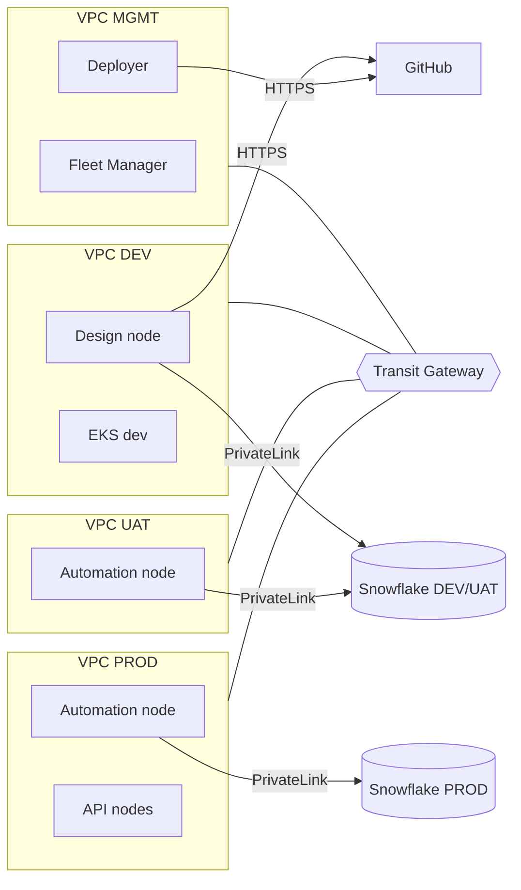

# Multi-VPC target design

The detailed target design for environment isolation: four VPCs (MGMT, DEV, UAT, PROD) joined by a Transit Gateway with blackhole routes, per-environment IAM, Snowflake PrivateLink per VPC, and per-group S3 storage. It was worked through with the vendor's field engineers and the cloud networking team. Parts of it were never built, and the open questions are at the end.

It assumes all four VPCs sit in one AWS account. If dev and prod have to live in separate AWS accounts, the per-environment controls here (separate VPCs, endpoint-scoped Snowflake rules, per-group buckets and roles) still apply, but the Transit Gateway routing and Fleet Manager placement would need redoing for that layout. If Snowflake PrivateLink is centralised in a network account, see [snowflake-network-isolation.md](snowflake-network-isolation.md#the-catch-a-central-network-account).

Decisions and rejected alternatives are listed in [decision-log.md](decision-log.md).

## The problem

A typical Cloud Stacks deployment starts life in one VPC. Fleet Manager, the Design node, the Automation nodes and the EKS clusters all share it, along with one security group and one IAM instance profile. Environments are separated by naming and by which credentials sit in which DSS connection.

That means the only thing stopping a Design node user from reaching PROD Snowflake or the PROD bucket is that nobody typed the PROD credentials into a DEV connection. Anyone who can run Python on the Design node and gets hold of those credentials (or the instance role) can reach production.

The goal of this design is that a DEV node *cannot* reach PROD data even with PROD credentials in hand, because the network and IAM won't carry the request.

## Layout

Four VPCs in the same AWS account:

| VPC  | Runs                                     | Snowflake                 | S3                          | Git          |
|------|------------------------------------------|---------------------------|-----------------------------|--------------|
| MGMT | Fleet Manager, Deployer, Govern          | none                      | FM backups only             | yes          |
| DEV  | Design node, DEV EKS cluster             | DEV/UAT account           | `dss-dev-*` buckets         | yes          |
| UAT  | Automation node (acceptance), UAT EKS    | DEV/UAT account           | `dss-uat-*` buckets         | no           |
| PROD | Automation node, API nodes, PROD EKS     | PROD account              | `dss-prod-*` buckets        | no           |

Separate VPCs rather than separate subnets in one VPC, for two reasons. Each VPC gets its own NAT gateway, so each environment has its own outbound IP if you ever need to allowlist by IP. And each VPC gets its own Snowflake PrivateLink endpoint, whose endpoint ID Snowflake can filter on (see [Snowflake network isolation](snowflake-network-isolation.md)).

## Routing between VPCs

Fleet Manager has to reach every DSS node on its main port, and the Deployer has to push bundles to the Automation and API nodes. Nothing else needs to cross environments.

Transit Gateway with one route table per attachment does this:

| TGW route table | Associated with | Routes                                                |
|-----------------|-----------------|-------------------------------------------------------|
| rt-mgmt         | MGMT            | propagated from all VPCs                              |
| rt-dev          | DEV             | MGMT only; blackhole for UAT and PROD CIDRs           |
| rt-uat          | UAT             | MGMT only; blackhole for DEV and PROD CIDRs           |
| rt-prod         | PROD            | MGMT only; blackhole for DEV and UAT CIDRs            |

Without the blackhole routes, a later change that propagates one environment's routes into another's table quietly opens a path.

### Fleet Manager and VPC peering

Fleet Manager can pair virtual networks itself, and its default IAM role carries `ec2:CreateVpcPeeringConnection`, `ec2:AcceptVpcPeeringConnection` and `ec2:DeleteVpcPeeringConnection` for that purpose. If it creates a peering connection alongside the Transit Gateway, you get a second path between VPCs that the blackhole routes don't cover.

Remove those three permissions from the FM role once the Transit Gateway is in place, and alarm on `ec2:DescribeVpcPeeringConnections` returning anything.

## IAM per environment

Each environment's nodes get their own instance profile, set in the Fleet Manager instance template ("Runtime instance profile ARN"). The Fleet Manager role then needs `iam:PassRole` on each of those roles, not just one shared role.

What each instance profile is allowed to do is covered in [S3 isolation per group](s3-group-isolation.md).

## Git

With projects backed by GitHub instead of DSS's internal Git, two components need outbound HTTPS to GitHub:

- the Design node, for push and pull during development;
- the Deployer, because it builds bundles from the project content.

Automation and API nodes receive bundles from the Deployer and never talk to Git, unless you turn on Git tracking for Automation nodes, which is off by default. UAT and PROD therefore get no route to GitHub.

## Promotion between environments

Bundles move from DEV to UAT to PROD through the Deployer. Connections differ per environment, so each deployment infrastructure needs connection remapping rules: `snowflake-dev` on the Design node becomes `snowflake-uat` on the acceptance node, and so on. With per-group S3 connections this becomes one remapping rule per group per environment, which is worth automating with the same pipeline that creates the connections.

## Cost drivers

The design adds a few fixed hourly charges: Transit Gateway attachments (one per VPC), NAT gateways (one or two per VPC depending on how many AZs you run), one interface endpoint per VPC for Snowflake, and flow logs. S3 gateway endpoints are free. At the time this was costed, the total was in the low hundreds of dollars a month, which was small next to the DSS licence and the EKS node groups.

## Open questions that were never closed

- Whether the organisation would allow PrivateLink endpoints to Snowflake inside the workload VPCs, instead of routing through the central network account. This decides whether Snowflake can enforce the environment boundary at all. See the last section of [Snowflake network isolation](snowflake-network-isolation.md).
- Whether Fleet Manager virtual networks behave as expected when each points at a different VPC in the same account. The vendor confirmed it was supported in principle. It was not tested end to end.
- How Deployer remapping holds up with a large number of per-group connections.
